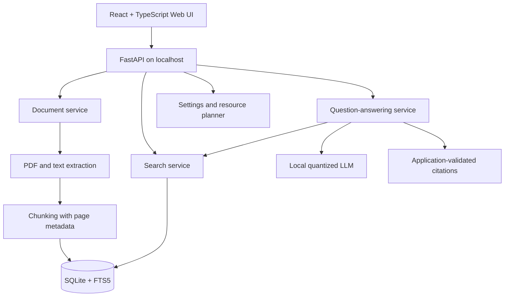

# ClearSheaf Search

**From scattered files to clear understanding.**

ClearSheaf Search is a private, local-first document intelligence application. Import your PDFs, text files, and Markdown notes, search across the whole library, and ask questions that are answered from your own documents with verifiable citations. Your files, indexes, and language-model inference stay on your computer.

[](https://github.com/hamza-flutterdev/clearsheaf-search/actions/workflows/ci.yml)
[](LICENSE)


> **Project status: pre-alpha.** ClearSheaf Search is being built milestone by milestone. The [roadmap](#roadmap) shows what is implemented today. A feature is not available until its milestone is checked off.

---

## Why ClearSheaf Search

Filename search fails when you remember an idea but not the exact words or the file it lives in. ClearSheaf Search lets you find the passage first, and then, if you want, ask a local model to answer from that passage.

- **Private by design.** No accounts, no telemetry, no hosted database, no paid API. Documents and questions never leave your machine.
- **Search that works without an AI model.** Full-text search is built on SQLite FTS5 and stays usable even if no language model is installed or it cannot load.
- **Answers you can verify.** Every answer cites the document and page it came from. Citations are generated by the application from retrieved passages, never invented by the model.
- **Honest abstention.** When the documents do not contain enough evidence, ClearSheaf Search says so instead of guessing.
- **You control the resources.** Choose CPU threads, context size, generation length, and GPU behavior so the app leaves room for your other work.

## Features

| Area | Description |
|---|---|
| Library | Import PDF, TXT, and Markdown files into a managed local library |
| Search | Keyword search across all documents or within one selected document |
| Ask | Grounded question answering with a single local quantized LLM |
| Citations | Source document, page number, and excerpt for every answer |
| Resources | Manual and recommended resource profiles, with a view of the configuration actually in effect |
| Web UI | React + TypeScript interface served locally by the FastAPI backend |
| API | Documented REST API under `/api/v1`, bound to loopback by default |
| Semantic search | Optional local embeddings and hybrid keyword + semantic ranking |

## Privacy

- The API binds to `127.0.0.1` by default.
- Imported files are copied into a managed per-user data directory. Your originals are never modified.
- No analytics or telemetry of any kind. File names, paths, document text, and questions are never sent anywhere.
- The only network activity is the one-time download of packages and model files.
- Document text, prompts, and model output are not written to logs by default.
- Deleting a document removes its managed copy, chunks, and index entries.

## Architecture



| Layer | Technology |
|---|---|
| Backend | Python 3.14, FastAPI, Pydantic |
| Storage | SQLite, SQLAlchemy 2.x, FTS5 |
| PDF extraction | pypdf |
| Local LLM | NobodyWho with a GGUF model, behind a replaceable adapter |
| Embeddings (optional) | sentence-transformers |
| Frontend | React, TypeScript, Vite |
| Tooling | uv, Ruff, pytest, GitHub Actions |

Design details live in [`docs/architecture.md`](docs/architecture.md) and the decision records in [`docs/decisions/`](docs/decisions/).

## Getting started

### Requirements

- Python 3.14 (installed automatically by `uv`)
- [`uv`](https://docs.astral.sh/uv/getting-started/installation/)
- Node.js and npm, using the version required by the Vite release pinned in `frontend/package.json`
- Free disk space for the document library and any model files you download
- 8 GB of RAM or more if you run a language model; keyword search needs far less

Tested on Ubuntu.

### Install

```bash
git clone https://github.com/hamza-flutterdev/clearsheaf-search.git
cd clearsheaf-search
uv sync
cd frontend
npm install
cd ..
```

### Run in development

Start the backend:

```bash
uv run uvicorn clearsheaf_search.main:app --host 127.0.0.1 --port 8000
```

Start the frontend in a second terminal:

```bash
cd frontend
npm run dev
```

Open the address printed by Vite, normally `http://127.0.0.1:5173`. The dev server proxies `/api` requests to the backend on port 8000.

### Verify the backend is running

```bash
curl http://127.0.0.1:8000/api/v1/health
```

### Language model

The language model is optional. Without one, the Library and Search features work normally and Ask reports that the model is not ready. Tested models and their licenses are listed in [`docs/MODEL_CARDS.md`](docs/MODEL_CARDS.md). Model files are never committed to this repository.

## Configuration

| Setting | Default | Purpose |
|---|---|---|
| `CLEARSHEAF_DATA_DIR` | OS per-user data directory | Location of the library, database, indexes, models, and logs |
| Host | `127.0.0.1` | Network interface the API binds to |
| Port | `8000` | API port |

Copy `.env.example` to `.env` to override defaults during development.

Resource settings such as CPU threads, context tokens, maximum new tokens, and GPU mode are managed from the Settings screen. A configured memory budget is a planning target, not a hard cap, and the UI shows the configuration that is actually in effect.

## Development

```bash
uv run ruff check .
uv run ruff format --check .
uv run pytest
```

Apply formatting with:

```bash
uv run ruff format .
```

Default tests never download a model and never use the network. Tests that need a real model are marked `slow` and run only on demand.

Frontend checks:

```bash
cd frontend
npm run lint
npm run build
```

### Repository layout

```text
clearsheaf-search/
├── frontend/          React + TypeScript + Vite Web UI
├── src/clearsheaf_search/
│   ├── api/           HTTP routes
│   ├── core/          configuration, errors, logging
│   ├── db/            SQLite models and repositories
│   ├── inference/     local LLM provider interface and adapters
│   ├── resources/     hardware detection and resource planning
│   ├── schemas/       Pydantic request and response models
│   ├── services/      ingestion, chunking, search, answering
│   └── storage/       managed file storage
├── tests/             unit, API, integration, evaluation, slow
├── docs/              architecture, decisions, model cards, benchmarks
└── scripts/           evaluation and benchmark scripts
```

## Roadmap

- [ ] Milestone 0: project scaffold, health endpoint, CI
- [ ] Milestone 1: SQLite schema and document metadata
- [ ] Milestone 2: safe file storage and text extraction
- [ ] Milestone 3: chunking and FTS5 keyword search
- [ ] Milestone 4: retrieval evaluation harness
- [ ] Milestone 5: local LLM adapter
- [ ] Milestone 6: grounded answering with validated citations
- [ ] Milestone 7: manual resource profiles
- [ ] Milestone 8: optional semantic and hybrid search
- [ ] Milestone 9: Web UI and end-to-end workflow
- [ ] Milestone 10: reliability, documentation, public release

## Known limitations

- Scanned or image-only PDFs have no extractable text and cannot be searched.
- Small models can follow instructions inconsistently. Measured answer quality is reported in [`docs/benchmarks.md`](docs/benchmarks.md).
- Prompt-based defenses do not eliminate prompt injection. The model has no tools, no file access, and no network access.
- Platform support is limited to configurations that have been tested and recorded.

## Contributing

Contributions are welcome. Please read [`CONTRIBUTING.md`](CONTRIBUTING.md) before opening a pull request. The `main` branch is protected: all changes go through pull requests with passing CI.

To report a security issue, follow [`SECURITY.md`](SECURITY.md) and do not open a public issue.

## License

ClearSheaf Search application code is released under the [MIT License](LICENSE).

Dependencies and models carry their own licenses. A model's license is separate from this project's license, and model weights are not redistributed here. See [`THIRD_PARTY_NOTICES.md`](THIRD_PARTY_NOTICES.md) and [`docs/MODEL_CARDS.md`](docs/MODEL_CARDS.md).

## Acknowledgments

Built with [FastAPI](https://fastapi.tiangolo.com/), [SQLite](https://www.sqlite.org/), [pypdf](https://pypdf.readthedocs.io/), [NobodyWho](https://docs.nobodywho.ai/), [sentence-transformers](https://www.sbert.net/), [React](https://react.dev/), and [Vite](https://vite.dev/).